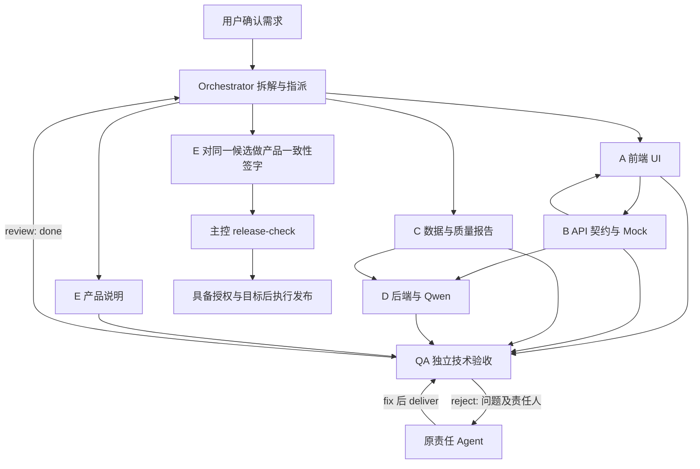

# 多 Agent 架构

本目录原先实现主控、A–E和QA基础框架，现已存在销售准备应用。2026-10-20按用户新要求增加M1—M5五个独立业务模块，原角色继续负责公共支撑与独立验收。以下原角色职责仍适用，当前五模块分工、worktree、合并main与权限详见`../协作工作区/协作开发与合并说明.md`。模块目录搭建不表示新业务流水线已实现或线上已改接。

## 角色与目录

| 角色 | 职责 | 允许写入 |
|---|---|---|
| Orchestrator | 需求分解、依赖调度、冲突仲裁、状态、备份与发布编排 | 框架、schemas、`.collaboration/`、主控文档与配置 |
| A | 前端界面、交互及接口需求 | `frontend/`、`docs/ui/`、`outputs/A/` |
| B | 唯一 API 契约、Mock、一致性检查 | `contracts/`、`mocks/`、`docs/api/`、`outputs/B/` |
| C | 运行/训练数据、清洗、来源及质量 | `data/`、`docs/data/`、`outputs/C/` |
| D | 后端、Qwen 接入及有明确需求的训练评估 | `backend/`、`models/`、`docs/backend/`、`outputs/D/` |
| E | 产品说明、需求功能映射、发布一致性签字 | `docs/product/`、`outputs/E/` |
| QA | 独立技术验收、问题归属及复验 | `reviews/` |

完整提示词在 `agents/`。跨目录允许只读与有依据的验证，修改必须由责任角色执行；主控与 QA 不代修业务文件。权限是运行协作约束，不是操作系统级安全隔离；工具访问也须遵守用户授权与环境权限。

## 输入输出与依赖

用户确认需求 → Orchestrator 拆解 → A 输出交互及接口需求 → B 固化契约 → A 与 D 按同版本实现 → B 检查一致性。C 按确认来源提供数据及质量报告 → D 审查接收 → 接入或评估模型。E 在确认用户、痛点后并行维护说明，最终与真实功能核对。

每份交付包含文件路径、摘要、验收证据和限制。B 契约是接口唯一事实来源；D 拒收 C 数据时说明具体质量缺口、证据和重交门槛，由主控分派修复任务。不要把 Mock、模拟记录或框架示例当成真实业务成果。

## 消息流与修复闭环

文字流程：主控指派 → 成员开始 → 成员交付 → QA 验收 → 不通过时回原责任成员修复 → 再交付与复验 → 技术通过 → E 对候选签字 → 主控检查发布条件。

消息必须按 `docs/protocol.md` 的 JSON 协议处理。状态由本地运行器统一写入 `.collaboration/state.json`，成员不能手动修改状态文件。当前运行器负责消息验证、任务状态与发布检查，不会自动运行模型、锁定模型名称、启动七个常驻服务或部署线上系统。七个角色是职责划分，要由主控在支持子 Agent 的宿主会话中加载提示词，并按宿主实际并发限额分批调度；不要求七个角色同时运行。

## 两个独立门禁

QA 验收每个有效任务的技术与文档质量。发布候选中的任务必须为 done 或保留原因的 cancelled，至少一个 E 产品说明任务经 QA 验收为 done。E 再检查候选与产品说明、用户痛点和功能承诺一致，提交绑定当前候选 fingerprint 的签字。两者都通过才允许主控继续发布；取消不能冒充验收，也不能使依赖自动通过。done 任务产出变化时由 QA reject 原任务，owner fix/deliver 后再复验；上游验收内容变化使下游 dependency_fingerprints 过期，QA 也须退回受影响下游原任务复验，最后 E 重新签字。框架阶段产品定位与业务用户仍待确认，不要求用虚构业务填满说明。

目录用途：`templates/` 提供需求、发布核对及模拟闭环；`schemas/` 定义消息与任务表结构；`framework/` 是本地状态运行器；`.collaboration/` 存储状态、消息、事件和备份；业务目录按上表分配。
