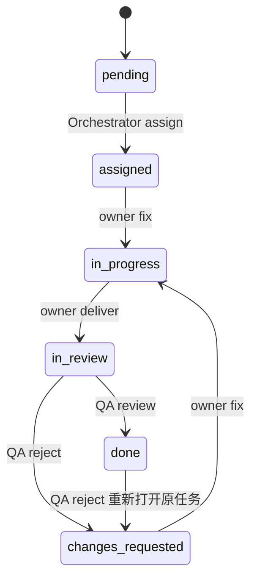

# 任务表与状态机

任务表位于 `.collaboration/state.json`，由 `framework/` 运行器统一管理，结构约束见 `schemas/task-board.schema.json`。主控负责创建、调度和追踪；角色通过结构化消息请求合法状态转换，QA 决定验收结果。

## 存储结构

顶层包含 `schema_version`、`revision`、`tasks`、`messages`、`events`、`release_approval`。`tasks` 是按任务 ID 索引的对象，任务包含负责人、标题、验收标准、依赖和状态，以及 `artifacts`、`artifact_hashes`、`dependency_fingerprints` 和验收信息。dependency_fingerprints 绑定交付时每个依赖任务 artifact_hashes 的指纹，以检测上游验收内容变化。完整字段、必填项与额外字段规则以 schema 为准；不要将本文的概念描述当作可直接导入的完整 JSON。

`messages` 保存已接受的完整信封，`events` 保存对应状态变化和审计事件，`release_approval` 保存 E 对当前候选的签字信息。状态采用单文件事务写入，防止任务表已经变更而消息未落盘。写入前自动备份，`snapshot` 可额外创建检查点。

## 状态含义

| 状态 | 含义 | 进入依据 |
|---|---|---|
| `pending` | 已建立任务，尚未分配执行 | 主控创建任务 |
| `assigned` | 已指派 owner | 主控 assign |
| `in_progress` | owner 正在实现或修复 | owner fix |
| `in_review` | 已交付，等待 QA | owner deliver |
| `changes_requested` | QA 提出未关闭问题 | QA reject |
| `blocked` | 存在记录在案的外部阻塞 | 主控 block，保存原状态 resume_status 和原因 |
| `done` | 当前交付已通过 QA，可因产出/依赖变更重新退回 | QA review；不是不可重开的终态 |
| `cancelled` | 任务被明确取消 | 主控 cancel，保留原因与事件 |

正常流转与修复流转如下：



主控可以执行 `block/cancel/resume --id ID --reason TEXT`，这些管理操作记录为事件，不新增消息 type。block 保存 `resume_status`，resume 仅接受 blocked 并恢复该原状态。done、cancelled 任务不能再 block 或 cancel；blocked 任务需要先 resume 才能 cancel。取消保留原因与历史，不等于 QA 通过；依赖要求 done，取消依赖不会自动放行后续任务。禁止直接编辑状态文件。

## 消息状态与任务状态的区别

消息信封的 `status` 是期望的新任务状态。消息是否送达/被拒绝由运行器结果及存储记录表示；此协议没有独立 `sent/received` 状态。某个 deliver 被拒绝时，任务不应因此被当作已在评审中。

任务 done 不等于已发布。发布要求所有任务为 done 或有原因记录的 cancelled，至少一个 E 产品说明任务已经 QA 验收为 done，并有 E 对当前候选的产品一致性签字。已完成文件改变时，QA 向原任务发 reject，原 owner 执行 fix → deliver 更新交付 hash，再经 QA review 复验；保留原有消息和评审历史。上游验收内容改变会使依赖它的下游 dependency_fingerprints 过期，下游即使仍为 done 也不能发布；QA 必须同样退回受影响下游原任务复验，再请 E 重新签字。仅新建修订任务不能解决原记录旧 hash。任务依赖未完成时不得先行开展依赖该成果的工作，确有并行草案时先拆分独立任务。

## 日常操作

从项目根目录执行：

```powershell
python -m framework init
python -m framework task --id SAMPLE-A --owner A --title "模拟前端任务" --acceptance "按明确标准验证模拟交付"
python -m framework send --file templates/message.assign.example.json
python -m framework block --id SAMPLE-A --reason "模拟：依赖条件暂不可用"
python -m framework resume --id SAMPLE-A --reason "模拟：条件恢复，回到原状态"
python -m framework validate
python -m framework snapshot
```

上面的 SAMPLE 任务和模板仅演示用法；模板 ID 和任务 owner 必须匹配。若该模拟任务不再需要，可由主控运行 `python -m framework cancel --id SAMPLE-A --reason "模拟任务结束，保留历史"`；cancelled 不可恢复，不能取消已经 done 的任务。使用临时目录的 demo 验证闭环，可避免把示例误作真实项目任务：`python -m framework demo --output 路径`。
