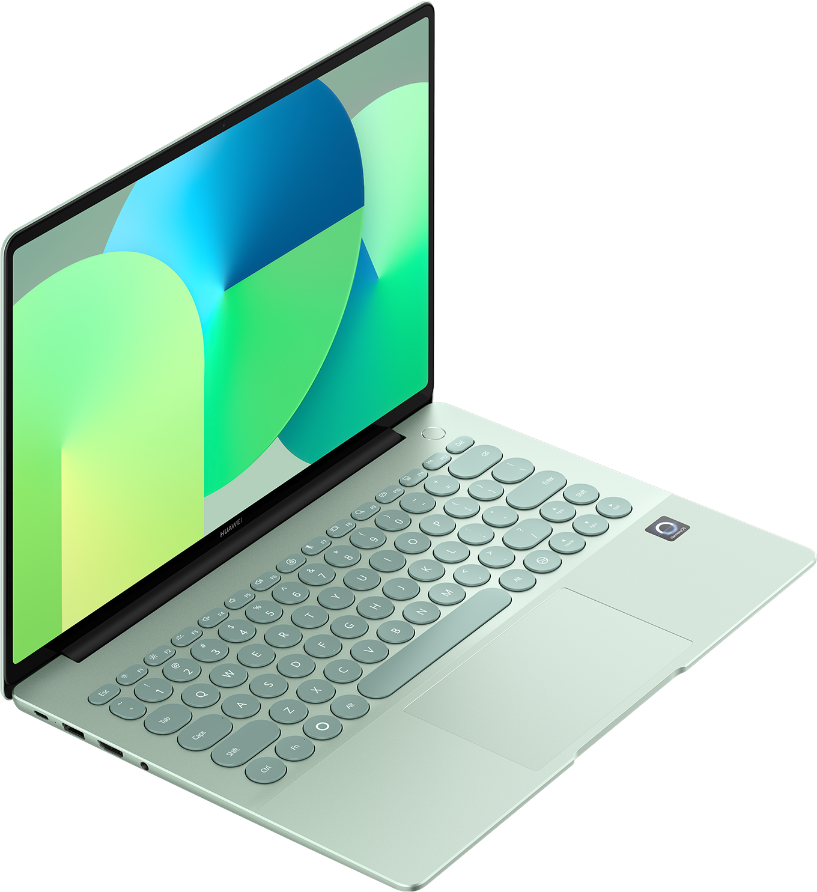
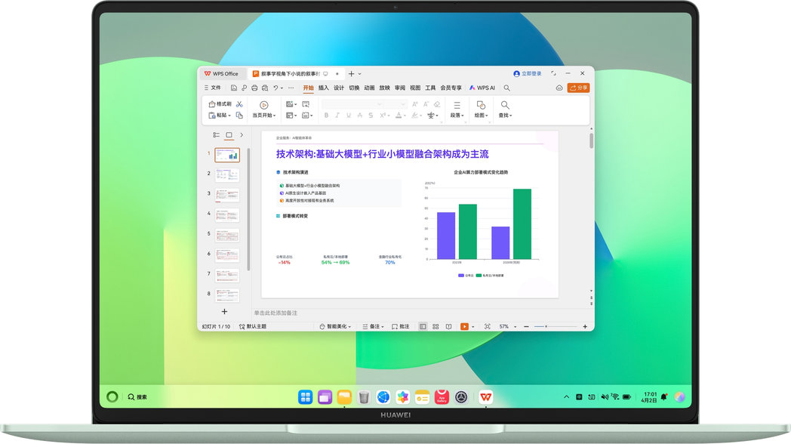
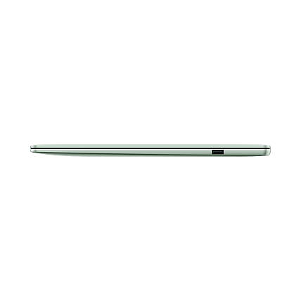
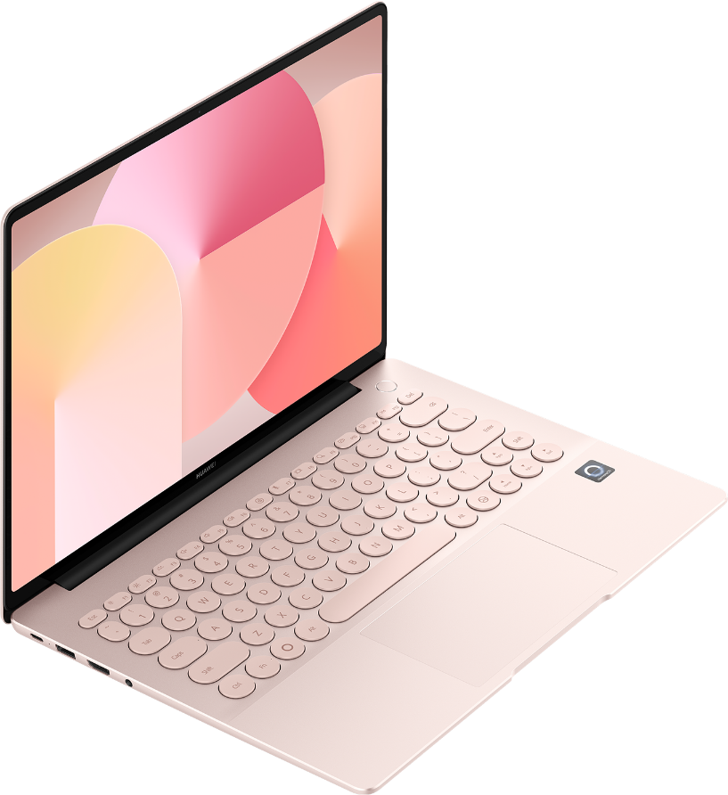

# 仓库与办公室轮用，别只看轻不轻

> 平台：公众号；内容结构：分层长文：场景 → 任务清单 → 原文核对 → 使用限制 → 下一步沟通；建议资料依据不超过 3 项；建议图片不超过 4 张。

轮换使用不是把电脑装进包里就结束了，真正麻烦的是每次换位置后的工作衔接。对要负责采购的人来说，最需要的是把条件、风险和待确认项放在同一张清单上。这次围绕“仓库与办公室轮用，需要移动办公”整理。

<!-- IMAGE:after_title -->
> **配图 1｜封面主视觉**
> 插入位置：标题和导语之后

> 图片：hwpc_matebook-14-harmonyos_原野绿多彩配色_04.png
> 说明：HUAWEI MateBook 14（鸿蒙版）原野绿外观示意；配色与配置请以实际销售版本为准。
> 来源：产品资料库“任德耀新建华为PC知识库”
> 状态：具体型号匹配已核验；公开发布授权与人工终审仍待确认。

## 先把任务说清楚

这次要处理的是“仓库与办公室轮用，需要移动办公”，候选型号是 HUAWEI MateBook 14（鸿蒙版）。设备会跟着人换位置，重量只是起点，接口、续航条件和文件流转更值得先问。

已知条件：移动办公、办公。仍需要重点确认：软件兼容性待确认。

换成制造企业采购负责人的日常动作，就是先看软件、文件、外设和携带频率，而不是先给型号下结论。

<!-- IMAGE:after_requirements -->
> **配图 2｜使用场景**
> 插入位置：任务说明之后

> 图片：hwpc_matebook-14-harmonyos_手写笔创作场景_07.jpg
> 说明：文档处理场景示意；应用、版本与屏幕内容请以实际设备和授权版本为准。
> 来源：产品资料库“任德耀新建华为PC知识库”
> 状态：具体型号匹配已核验；公开发布授权与人工终审仍待确认。

## 资料里能先确认什么

下面只摘与当前任务相关的原文项，参数值不改写，也不把公开资料当成实测体验。

- **重量：** 约 1.33 kg（圆键盘含电池）
- **屏幕分辨率：** 2880 × 1920，243 PPI
- **电池容量：** 70 Wh（额定容量）

资料出处：HUAWEI MateBook 14（鸿蒙版） 产品资料。

<!-- IMAGE:after_facts -->
> **配图 3｜机身细节**
> 插入位置：资料摘录之后

> 图片：vmall_matebook-14-harmonyos_轻薄原野绿侧面细节_04.png
> 说明：机身侧面与接口位置示意；接口配置与销售版本请按官网规格复核。
> 来源：产品资料库“任德耀新建华为PC知识库”
> 状态：具体型号匹配已核验；公开发布授权与人工终审仍待确认。

## 哪些事还不能替你下结论

- 软件兼容要按名称、版本、文件格式和外设逐项确认，看到型号资料不等于已经验证兼容。
- 实际续航、发热和手感会受使用方式影响，公开资料不能替代真实体验。
- 颜色、键盘、内存和存储等完整销售配置仍需确认；价格、库存和交付条件不能从公开参数里推出来。

<!-- IMAGE:before_cta -->
> **配图 4｜行动引导前配图**
> 插入位置：行动引导之前

> 图片：hwpc_matebook-14-harmonyos_多彩配色外观_01_7e0eedb6.png
> 说明：HUAWEI MateBook 14（鸿蒙版）樱粉金外观示意；配色与配置请以实际销售版本为准。
> 来源：产品资料库“任德耀新建华为PC知识库”
> 状态：具体型号匹配已核验；公开发布授权与人工终审仍待确认。

## 下一步沟通

如果你正在核对“仓库与办公室轮用，需要移动办公”，把常用软件和版本、主要文件格式、外设，以及需要携带的频率发来。我们先按条件列清单，再确认演示和报价。

## 预算核对

> 当前状态：客户未提供。客户未提供预算；不推断预算充足性，也不输出交易报价。

---

## 发布前检查结果

> 总体结论：需要调整；原稿可直接发布：否；稳妥版本：可用。

| 检查项 | 结果 | 说明 |
| --- | --- | --- |
| 产品型号 | 通过 | 发布型号“HUAWEI MateBook 14（鸿蒙版）”与 3 条产品资料中的具体型号一致。 |
| 产品参数 | 通过 | 3 项产品参数与型号、原文和使用限制一致。 |
| 价格与报价 | 通过 | 未发现金额、成交价或折扣承诺；当前没有可宣称的最新交易报价。 |
| 图片来源 | 需要调整 | 4张图片型号与来源通过，但4张缺少公开发布授权；安全版本已移除图片。 |
| 表达边界 | 通过 | 未发现绝对化、成交、兼容性或效果承诺。 |
| 资料来源 | 通过 | 3 项产品资料与 4 张图片均保留了可核对的资料来源。 |

## 需要处理的问题

- 图片公开发布授权未完成｜4张图片仅通过型号/来源辅助核验，尚未完成正式发布授权。｜怎么处理：从可发布版本移除全部图片和图片标记；授权完成后再单独复核。

## 图片来源清单

> 图片只用于内部审稿；公开发布授权和人工终审仍需确认。

| # | 画面说明 | 资料来源 | 状态 |
| --- | --- | --- | --- |
| 1 | HUAWEI MateBook 14（鸿蒙版）原野绿外观示意；配色与配置请以实际销售版本为准。 | 华为PC产品资料库｜华为公开产品素材 | 型号一致；发布授权待确认 |
| 2 | 文档处理场景示意；应用、版本与屏幕内容请以实际设备和授权版本为准。 | 华为PC产品资料库｜华为公开产品素材 | 型号一致；发布授权待确认 |
| 3 | 机身侧面与接口位置示意；接口配置与销售版本请按官网规格复核。 | 华为PC产品资料库｜华为公开产品素材 | 型号一致；发布授权待确认 |
| 4 | HUAWEI MateBook 14（鸿蒙版）樱粉金外观示意；配色与配置请以实际销售版本为准。 | 华为PC产品资料库｜华为公开产品素材 | 型号一致；发布授权待确认 |

## 资料来源

- HUAWEI MateBook 14（鸿蒙版） 产品资料｜https://consumer.huawei.com/cn/harmonyos-computer/matebook-14-harmonyos-version/
- HUAWEI MateBook 14（鸿蒙版） 产品资料｜https://consumer.huawei.com/cn/harmonyos-computer/matebook-14-harmonyos-version/
- HUAWEI MateBook 14（鸿蒙版） 产品资料｜https://consumer.huawei.com/cn/harmonyos-computer/matebook-14-harmonyos-version/

## 可发布安全版本

> 发布前检查结论：需要调整；通过 5 项、需要调整 1 项、不通过 0 项。以下版本已移除不合适内容，但仍须由发布负责人最终确认。

# 仓库与办公室轮用，别只看轻不轻

轮换使用不是把电脑装进包里就结束了，真正麻烦的是每次换位置后的工作衔接。对要负责采购的人来说，最需要的是把条件、风险和待确认项放在同一张清单上。这次围绕“仓库与办公室轮用，需要移动办公”整理。

## 先把任务说清楚

这次要处理的是“仓库与办公室轮用，需要移动办公”，候选型号是 HUAWEI MateBook 14（鸿蒙版）。设备会跟着人换位置，重量只是起点，接口、续航条件和文件流转更值得先问。

已知条件：移动办公、办公。仍需要重点确认：软件兼容性待确认。

换成制造企业采购负责人的日常动作，就是先看软件、文件、外设和携带频率，而不是先给型号下结论。

## 资料里能先确认什么

下面只摘与当前任务相关的原文项，参数值不改写，也不把公开资料当成实测体验。

- **重量：** 约 1.33 kg（圆键盘含电池）
- **屏幕分辨率：** 2880 × 1920，243 PPI
- **电池容量：** 70 Wh（额定容量）

资料出处：HUAWEI MateBook 14（鸿蒙版） 产品资料。

## 哪些事还不能替你下结论

- 软件兼容要按名称、版本、文件格式和外设逐项确认，看到型号资料不等于已经验证兼容。
- 实际续航、发热和手感会受使用方式影响，公开资料不能替代真实体验。
- 颜色、键盘、内存和存储等完整销售配置仍需确认；价格、库存和交付条件不能从公开参数里推出来。

## 下一步沟通

如果你正在核对“仓库与办公室轮用，需要移动办公”，把常用软件和版本、主要文件格式、外设，以及需要携带的频率发来。我们先按条件列清单，再确认演示和报价。

## 发布说明

- 从可发布版本移除全部图片和图片标记；授权完成后再单独复核。

## 使用边界

- 产品资料只来自上列可核对内容，没有把摘要或未经核对的信息补成产品参数。
- 客户画像只用于匹配任务与沟通角度，不推断预算、身份或采购权限。
- 未生成正式报价，未承诺软件兼容、咨询量或成交转化。
- 生成时间：2026/10/22 20:48。
